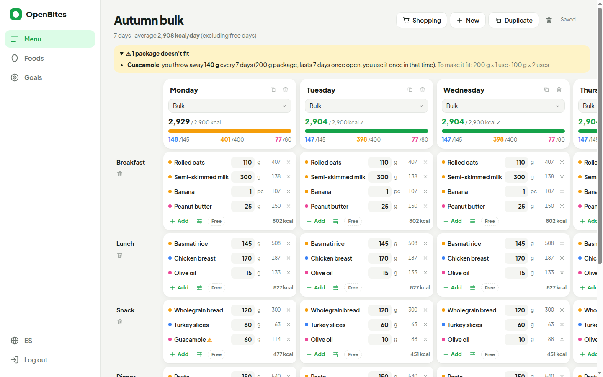
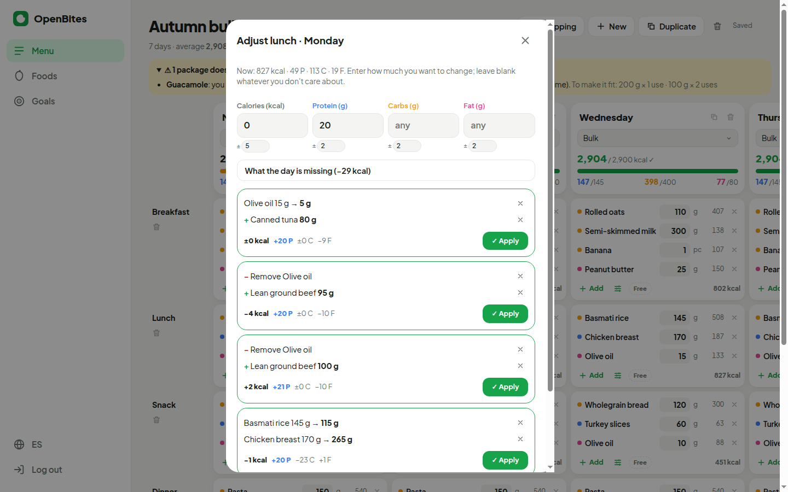
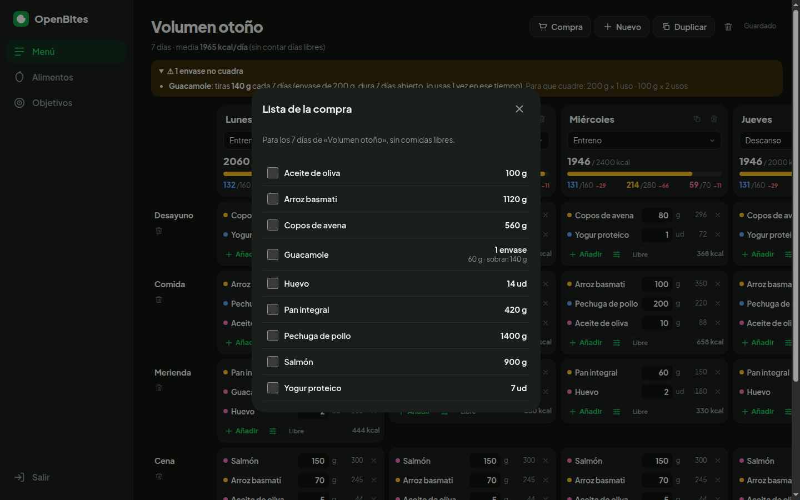
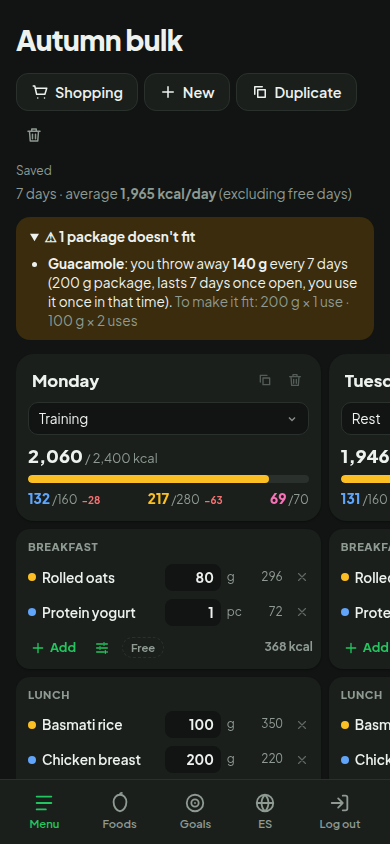

# OpenBites

**Plan your weekly meals like a spreadsheet — and let the app do the macro math.**

OpenBites is a personal meal-planning web app. You build a weekly (or two-week, or any length) menu from your own foods, and it computes calories, protein, carbs and fat for every meal and day, compares each day against its goal, and suggests exact tweaks to hit a macro target.

> The UI is in **Spanish** on purpose: it's built for my family, who will use it day to day.



## Features

- **Spreadsheet-style weekly menu** — days as columns, meals as rows. Edit grams inline, duplicate days, add/remove meals, mark a meal as a *free meal* (excluded from totals).
- **Your own food database** — macros per 100 g, optional grams-per-unit (“2 eggs”), package size and shelf life once opened. Foods can be created straight from a menu cell.
- **Daily goals by day type** — e.g. *Training* vs *Rest*. Each day shows kcal progress and per-macro surplus/deficit; it turns green when within ±20 kcal and ±5 g per macro.
- **Macro adjuster** — ask a meal for “+20 g protein, same kcal” and get the 5 best concrete edits: change an amount, add, remove or swap a food, or a combination of two. Amounts snap to 5 g steps or whole units and respect per-food min/max.
- **Package waste warnings** — simulates opening and finishing packages across repeated weeks and tells you when a portion doesn't fit (“you throw away 140 g of guacamole every week — use 200 g × 1 or 100 g × 2”).
- **Shopping list** — totals per food for the whole menu, in grams, units or packages.
- **Synced across devices** — data lives in Supabase behind passwordless email login; responsive layout for phone and desktop, light and dark themes.

| Macro adjuster | Shopping list | Mobile |
|---|---|---|
|  |  |  |

## Tech stack

- **React 19 + TypeScript + Vite** — no UI framework; hand-written CSS with design tokens.
- **Supabase** — Postgres + magic-link auth, row-level security per user.
- **Vitest** — unit tests for all the calculation logic.

## How it works

All the domain logic lives in [`src/core`](src/core) as pure, dependency-free TypeScript, so it's fully unit-tested and independent of React and Supabase.

### Macro adjuster ([`adjuster.ts`](src/core/adjuster.ts))

Deterministic search over “moves” (change, add, remove, swap) with at most two foods involved:

1. Each food contributes a linear vector of macros per gram/unit, weighted by the user's tolerance for each macro.
2. For one food, the optimal amount is a 1-D least-squares solution; for a pair, a 2×2 normal-equations system. Swaps are “remove A, then solve for B”.
3. Solutions are rounded to valid steps (5 g / whole units), checked against min/max, de-duplicated, and ranked: *within tolerance* first, then fewer changes, lower weighted error, and fewer grams moved.

With ~200 foods this is about 20k small systems and runs in roughly 250 ms.

### Package waste ([`packages.ts`](src/core/packages.ts))

The menu is treated as a repeating cycle. The simulation opens a package at first use, consumes each portion, and discards leftovers once the package has been open longer than its shelf life. Averaging over many cycles gives packages bought and grams wasted per cycle, which also drive the shopping list.

### Data model

A single `objects` table stores each food, day type and menu as a JSON document (`kind` + `data jsonb`), protected by RLS (`user_id = auth.uid()`). Menus are always read and edited as a whole, so there's nothing to gain from normalizing them.

## Running locally

```bash
npm install
cp .env.example .env.local   # fill in your Supabase URL and publishable key
npm run dev
npm test
```

### Supabase setup

1. Create a project and run [`supabase/schema.sql`](supabase/schema.sql) in the SQL editor.
2. In **Authentication → URL Configuration**, set the Site URL to your app URL (e.g. `http://localhost:5173`).
3. Optional: run [`supabase/keep-alive.sql`](supabase/keep-alive.sql) and add `SUPABASE_URL` / `SUPABASE_KEY` as repository secrets. A [scheduled GitHub Action](.github/workflows/keep-alive.yml) then pings the database every 5 days so the free tier never pauses the project.

## Project docs

Built following a spec → plan → build → test → review → ship workflow:

- [Specification](docs/SPEC.md)
- [Implementation plan](docs/PLAN.md)
